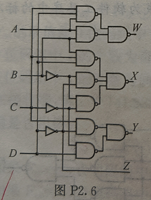

# 2025数字逻辑 - 期中演练作业题目与作答清单

## 一、单选题

### R2-1 (分数: 2分)

16路数据分配器，地址输入端有（ ）。

**选项：**

- [x] **A.** 4
- [ ] **B.** 3
- [ ] **C.** 2
- [ ] **D.** 16

### R2-2 (分数: 2分)

关于组合逻辑电路，下面正确的说法是（ ）。

**选项：**

- [ ] **A.** 输出状态由当前输入和以往状态共同决定
- [ ] **B.** 可实现“记忆”的逻辑功能
- [x] **C.** 输出仅取决于该时刻的输入状态，与电路原来状态无关
- [ ] **D.** 可构成“反馈型”的电路结构

## 二、主观题

### R8-1 第一章（1） (分数: 10分)

#### 题目描述

将下列十进制数化为二进制数：（小数点后保留4位即可）

49 ， 53 ， 7.943 ， 79.43

---

### R8-2 第二章第（6）题

#### 题目描述

图2.6所示为两种十进制数代码转换器，输入为余三码，输出为什么代码？

