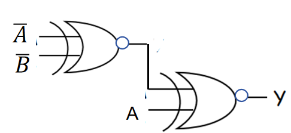

# 2025数字逻辑 - 第一周作业题目与作答清单

## 一、单选题

### R2-1 (分数: 2分)

八进制数(273)中，它的最高位2 的位权是十进制的( )。

**选项：**

- [ ] **A.** 256
- [ ] **B.** 128
- [ ] **C.** 8
- [x] **D.** 64

### R2-2 (分数: 2分)

在数字系统里，当某一线路作为总线使用，那么接到该总线的所有输出设备(或器件)必须具有( )结构，否则会产生数据冲突。

**选项：**

- [x] **A.** 三态门
- [ ] **B.** 异或门
- [ ] **C.** 与非门
- [ ] **D.** 或非门

### R2-3 (分数: 2分)

下图逻辑电路的输出值是（ ）

**选项：**

- [x] **A.** $B$
- [ ] **B.** $\overline{A} \odot B$
- [ ] **C.** $\overline{A} \odot B$
- [ ] **D.** $\overline{B}$

### R2-4 (分数: 1分)

逻辑函数 $F=A\oplus(\overline{A}\oplus P)=$（ ）

**选项：**

- [x] **A.** $\overline{P}$
- [ ] **B.** $A\oplus P$
- [ ] **C.** $\overline{A}\oplus P$
- [ ] **D.** $P$

### R2-5 (分数: 2分)

在奇偶校验码中，前六位 $I_0\sim I_5$ 为需要传输的数据，第七位 $I_6$ 为校验位，若采用奇校验，则（ ）。

**选项：**

- [ ] **A.** $I_6=I_0\oplus I_1\oplus I_2\oplus I_3\oplus I_4\oplus I_5$
- [ ] **B.** $I_6=\overline{I_0\odot I_1\odot I_2\odot I_3\odot I_4\odot I_5}$
- [x] **C.** $I_6=I_0\odot I_1\odot I_2\odot I_3\odot I_4\odot I_5$
- [ ] **D.** $I_6=I_0+I_1+I_2+I_3+I_4+I_5$

### R2-6 (分数: 2分)

三态输出门集成电路的特点是（ ）。

**选项：**

- [ ] **A.** 输出端悬空，形成与输入端不同电压值的高、低电平。
- [ ] **B.** 能形成“线与”的功能。
- [ ] **C.** 无论何种状态，输出端始终呈现“高阻抗”现象。
- [x] **D.** 输入端控制输出端，可呈现出高、低电平及“高阻抗”3种状态。

### R2-7 (分数: 2分)

若数据发送方送来奇校验码共6位（$I_5\sim I_0$），如果无传送错误，则满足（ ）。

**选项：**

- [ ] **A.** $I_5\cdot I_4\cdot I_3\cdot I_2\cdot I_1\cdot I_0 = 1$
- [ ] **B.** $\overline{I_5\oplus I_4\oplus I_3\oplus I_2\oplus I_1\oplus I_0} = 1$
- [x] **C.** $I_5\oplus I_4\oplus I_3\oplus I_2\oplus I_1\oplus I_0 = 1$
- [ ] **D.** $I_5\odot I_4\odot I_3\odot I_2\odot I_1\odot I_0 = 1$

## 二、主观题

### R8-1 第一章(1) (分数: 10分)

#### 题目描述

将下列十进制数化为二进制数：（小数点后保留4位即可）

49 ， 53 ， 7.943 ， 79.43

答案直接写在答题框内。

#### 提交答案 / 作答内容

$(49)_{10} \to (110001)_2 \to (61)_8$

$(53)_{10} \to (110101)_2 \to (65)_8$

$(7.943)_{10} \to (111.1111)_2 \to (7.74)_8$

$(79.43)_{10} \to (1001111.0111)_2 \to (117.34)_8$

---

### R8-2 第一章(2) (分数: 10分)

#### 题目描述

将下列二进制数转换成十进制数：（小数点后保留4位即可）

1010 ， 0.10011 ， 01101

#### 提交答案 / 作答内容

$(1010)_2 \to (10)_{10} \to (12)_8$

$(0.10011)_2 \to (0.59375)_{10} \to (0.46)_8$

$(01101)_2 \to (13)_{10} \to (15)_8$

---

### R8-3 第一章(3) (分数: 10分)

#### 题目描述

将下列十进制数转换成 8421BCD 码

2026 ， 65.3

#### 提交答案 / 作答内容

$(2026)_{10} \to (0010\ 0000\ 0010\ 0110)_{8421}$

$(65.3)_{10} \to (0110\ 0101.0011)_{8421}$

---

### R8-4 第一章第(6)题 (分数: 10分)

#### 题目描述

用真值表证明恒等式

$\overline{A}\oplus\overline{B}\oplus\overline{C}=A\oplus\overline{B}\oplus C$

#### 提交答案 / 作答内容

| $A$ | $B$ | $C$ | $\overline{A}$ | $\overline{B}$ | $\overline{C}$ | $\overline{A}\oplus\overline{B}\oplus\overline{C}$ | $A\oplus\overline{B}\oplus C$ |
| :-: | :-: | :-: | :-: | :-: | :-: | :-: | :-: |
| 0 | 0 | 0 | 1 | 1 | 1 | 1 | 1 |
| 0 | 0 | 1 | 1 | 1 | 0 | 0 | 0 |
| 0 | 1 | 0 | 1 | 0 | 1 | 0 | 0 |
| 0 | 1 | 1 | 1 | 0 | 0 | 1 | 1 |
| 1 | 0 | 0 | 0 | 1 | 1 | 0 | 0 |
| 1 | 0 | 1 | 0 | 1 | 0 | 1 | 1 |
| 1 | 1 | 0 | 0 | 0 | 1 | 1 | 1 |
| 1 | 1 | 1 | 0 | 0 | 0 | 0 | 0 |

---
