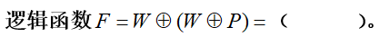
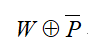
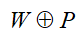
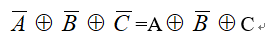

# 2025数字逻辑 - 第一周作业题目与作答清单

## 一、单选题

### R2-1 (分数: 2分)

八进制数（273）中，它的最高位2 的位权是十进制的（ ）。

**选项：**

- [ ] **A.** 256
- [ ] **B.** 128
- [ ] **C.** 8
- [x] **D.** 64

### R2-2 (分数: 2分)

在数字系统里，当某一线路作为总线使用，那么接到该总线的所有输出设备（或器件）必须具有（ ）结构，否则会产生数据冲突。

**选项：**

- [x] **A.** 三态门
- [ ] **B.** 异或门
- [ ] **C.** 与非门
- [ ] **D.** 或非门

### R2-3 (分数: 2分)

**选项：**

- [ ] **A.** 
- [x] **B.** P
- [ ] **C.** 
- [ ] **D.** W

### R2-4 (分数: 1分)

逻辑函数 $F=A\oplus{(\bar{A}}\oplus{P})$ =( )

**选项：**

- [x] **A.** $\bar{P}$
- [ ] **B.** $A\oplus{P}$
- [ ] **C.** $\bar{A}\oplus{P}$
- [ ] **D.** P

### R2-5 (分数: 2分)

在奇偶校验码中，前六位I0-I5为需要传输的数据，第七位I6为校验位，若采用奇校验，则（ ）。

**选项：**

- [ ] **A.** I6=I0⊕I1⊕I2⊕I3⊕I4⊕I5
- [ ] **B.** I6= $\overline{I0⊙I1⊙I2⊙I3⊙I4⊙I5}$
- [x] **C.** I6=I0⊙I1⊙I2⊙I3⊙I4⊙I5
- [ ] **D.** I6=I0+I1+I2+I3+I4+I5

### R2-6 (分数: 2分)

三态输出门集成电路的特点是（ ）

**选项：**

- [ ] **A.** 输出端悬空，形成与输入端不同电压值的高、低电平。
- [ ] **B.** 能形成“线与”的功能。
- [ ] **C.** 无论何种状态，输出端始终呈现“高阻抗”现象。
- [x] **D.** 输入端控制输出端，可呈现出高、低电平及“高阻抗”3种状态。

### R2-7 (分数: 2分)

若数据发送方送来奇校验码共6位（I5-I0），如果无传送错误，则满足（ ）。

**选项：**

- [ ] **A.** I5·I4·I3·I2·I1·I0 = 1
- [ ] **B.** $\overline{I5⊕I4⊕I3⊕I2⊕I1⊕I0} = 1$
- [x] **C.** I5⊕I4⊕I3⊕I2⊕I1⊕I0 = 1
- [ ] **D.** I5⊙I4⊙I3⊙I2⊙I1⊙I0 = 1

## 二、主观题

### R8-1 第一章（1） (分数: 10分)

#### 题目描述

将下列十进制数化为二进制数：（小数点后保留4位即可）
49 ， 53 ， 7.943 ， 79.43

答案直接写在答题框内。

#### 提交答案 / 作答内容

（49）10 ->（110001）2 ->（61）8

（53）10 -> （110101）2 -> （65）8

（7.943）10 -> （111.1111）2 ->（7.74）8

（79.43）10 -> （1001111.0111）2->（117.34）8

---

### R8-2 第一章（2） (分数: 10分)

#### 题目描述

将下列二进制数转换成十进制数 ：（小数点后保留4位即可）
1010 ， 0.10011 ， 01101

#### 提交答案 / 作答内容

（1010）2 -> （10）10 -> （12）8

（0.10011）2 -> （0.59375）10 -> （0.46）8

（01101）2 -> （13）10 -> （15）8

---

### R8-3 第一章（3） (分数: 10分)

#### 题目描述

将下列十进制数转换成8421BCD码

2026 ， 65.3

#### 提交答案 / 作答内容

（1997）10 ->（0001 1001 1001 0111）8421

（65.312）10 -> （0110 0101.0011 0001 0010）8421

---

### R8-4 第一章第（6）题 (分数: 10分)

#### 题目描述

用真值表证明恒等式

#### 提交答案 / 作答内容

| A | B | C | $\overline{A}$ |$\overline{B}$ | $\overline{C}$|$\overline{A}$⊕$\overline{B}$⊕$\overline{C}$ | A⊕$\overline{B}$⊕C |

|:-:|:-:|:-:|:-----:|

| 0 | 0 | 0 | 1 |1| 1 |1 |1 |

| 0 | 0 | 1 | 1 |1| 0 | 0 | 0 |

| 0 | 1 | 0 | 1 |0| 1 | 0 | 0 |

| 0 | 1 | 1 | 1 |0| 0 | 1 | 1 |

| 1 | 0 | 0 | 0 |1| 1 | 0 | 0 |

| 1 | 0 | 1 | 0 |1| 0 | 1 | 1 |

| 1 | 1 | 0 | 0 |0| 1 | 1 | 1 |

| 1 | 1 | 1 | 0 |0| 0 | 0 | 0 |

---
