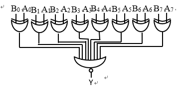
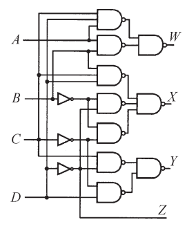
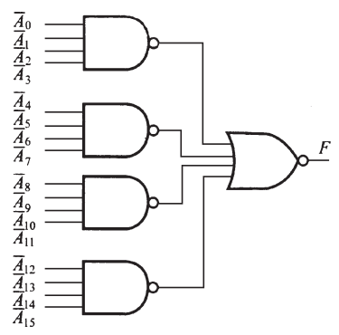

# 2025数字逻辑 - 第二周作业题目与作答清单

## 一、单选题

### R2-1 (分数: 2分)

关于组合逻辑电路，下面正确的说法是（ ）。

**选项：**

- [ ] **A.** 输出状态由当前输入和以往状态共同决定
- [x] **B.** 输出仅取决于该时刻的输入状态，与电路原来状态无关
- [ ] **C.** 可构成“反馈型”的电路结构
- [ ] **D.** 可实现“记忆”的逻辑功能

### R2-2 (分数: 2分)

设计一个四位二进制码的奇偶位发生器（假定采用偶检验码），需要（ ）个异或门。

**选项：**

- [ ] **A.** 2
- [x] **B.** 3
- [ ] **C.** 4
- [ ] **D.** 5

### R2-3 (分数: 2分)

以下哪个逻辑可以实现加法的“本位和”的运算（ ）。

**选项：**

- [ ] **A.** 与非
- [ ] **B.** 或非
- [ ] **C.** 同或
- [x] **D.** 异或

### R2-4 (分数: 2分)

卡诺图上变量的取值顺序是采用（ ）的形式，以便能够用几何上的相邻关系表示逻辑上的相邻。

**选项：**

- [x] **A.** 格雷码（循环码）
- [ ] **B.** ASCII码
- [ ] **C.** 十进制码
- [ ] **D.** 二进制码

### R2-5 (分数: 2分)

双向数据总线可以采用（ ）构成。

**选项：**

- [ ] **A.** 译码器
- [ ] **B.** 数据分配器
- [x] **C.** 三态门
- [ ] **D.** 数据选择器

### R2-6 (分数: 2分)

电路完成的功能是（ ）。

**选项：**

- [ ] **A.** A7--A0小于B7--B0时，输出=1
- [ ] **B.** A7--A0大于B7--B0时，输出=1
- [ ] **C.** 只要A7--A0输入为1时，输出=1
- [x] **D.** A7--A0等于B7--B0时，输出=1

### R2-7 (分数: 2分)

若ABCDEFGH为最小项，则它的逻辑相邻项有（ ）个。

**选项：**

- [x] **A.** 8
- [ ] **B.** 32
- [ ] **C.** 64
- [ ] **D.** 16

### R2-8 (分数: 2分)

已知逻辑表达式 $F=AB+\overline{A}C+\overline{B}C$，与它功能相等的函数表达式是（ ）。

**选项：**

- [ ] **A.** $F=AB$
- [ ] **B.** $F=AB+\overline{A}C$
- [x] **C.** $F=AB+C$
- [ ] **D.** $F=AB+\overline{B}C$

## 二、主观题

### R8-1 第一章第8题 (分数: 10分)

#### 题目描述

用布尔代数化简各逻辑函数表达式。

(1) $F=A+ABC+A\overline{B}\,\overline{C}+CB+\overline{C}\,\overline{B}$；

(2) $F=A\overline{B}CD+AB\overline{C}\,\overline{D}+A\overline{B}+A\overline{D}+A\overline{B}C$；

(3) $F=ABC\overline{D}+ABD+BC\overline{D}+ABCD+B\overline{C}$；

(4) $F=\overline{\overline{AC+\overline{A}BC}+\overline{B}C+AB\overline{C}}$。

---

### R8-2 第一章第（10）题 (分数: 10分)

#### 题目描述

用卡诺图化简下列各式：

(1) $F=\overline{AC+\overline{A}BC+\overline{B}C}+AB\overline{C}$；

(2) $F=A\overline{B}CD+AB\overline{C}\,\overline{D}+A\overline{B}+A\overline{D}+A\overline{B}C$；

(3) $F(A,B,C,D)=\sum m(0,1,2,5,6,7,8,9,13,14)$；

(4) $F(A,B,C,D)=\sum m(0,13,14,15)+\sum\phi(1,2,3,9,10,11)$。

---

### R8-3 等价变换 (分数: 10分)

#### 题目描述

分别用与非门、或非门实现下列函数，写出表达式并画图。

(1) $F=AB\overline{C}+A\overline{B}\,\overline{C}$；

(2) $F=\overline{(A+B)(C+D)}$；

(3) $F(A,B,C,D)=\sum m(0,1,2,4,6,10,14,15)$，用卡诺图化简后用与非门、或非门实现。

---

### R8-4 第二章第（3）题 (分数: 10分)

#### 题目描述

下图所示为两种十进制数代码转换器，输入为余三码，输出为什么代码？

---

### R8-5 第二章第（4）题 (分数: 10分)

#### 题目描述

图所示为数据总线上的一种判零电路，写出 $F$ 的逻辑表达式，说明该电路的逻辑功能。（$\overline{A}$ 表示反变量输入，即 $A$ 取反）

---
