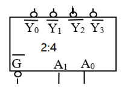
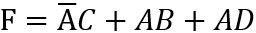
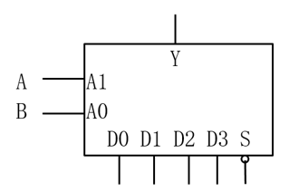
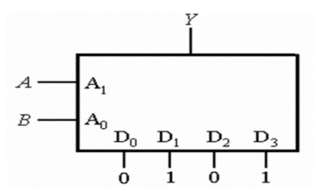
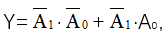
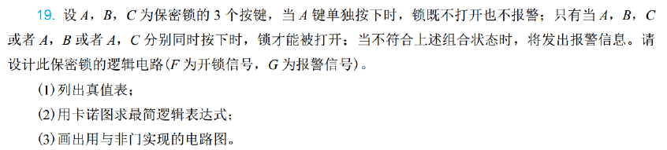
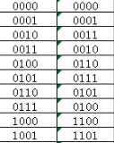
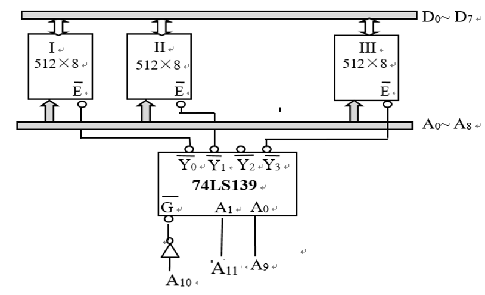
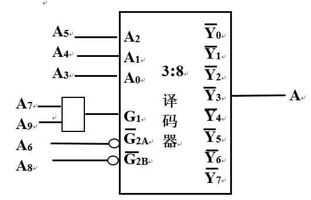

# 2025数字逻辑 - 第三周作业题目与作答清单

## 一、单选题

### R2-1 (分数: 2分)

将图示2:4译码器扩充为4:16译码器，则至少需要（ ）个2:4译码器。（只能使用2:4译码器）

**选项：**

- [ ] **A.** 6
- [ ] **B.** 4
- [ ] **C.** 3
- [x] **D.** 5

### R2-2 (分数: 2分)

复制内容

**选项：**

- [ ] **A.** 1000H~1400H
- [ ] **B.** 1000H~12FFH
- [ ] **C.** 1000H~1300H
- [x] **D.** 1000H~13FFH

### R2-3 (分数: 2分)

以下关于格雷码的错误描述为（ ）

**选项：**

- [ ] **A.** 格雷码可以用来检测数据的传输是否出错
- [ ] **B.** 相邻的格雷码只有一位不同
- [x] **C.** 格雷码可消除竞争冒险
- [ ] **D.** 格雷码是一组可靠性代码

### R2-4 (分数: 2分)

利用四选1数据选择器实现函数

，数据输入端接法为（ ）。S接低电平‘0’。
(提示：将F的卡诺图做出来，在卡诺图上地址的控制范围内化简)

**选项：**

- [x] **A.** D0=C,D1=C,D2=D,D3=1
- [ ] **B.** 复制内容
- [ ] **C.** D0=0,D1=C,D2=1,D3=0
- [ ] **D.** D0=D1=C,D2=1,D3=D

### R2-5 (分数: 2分)

下图为数据选择器构成的函数发生器，其输出逻辑式为

**选项：**

- [ ] **A.** Y=AB
- [ ] **B.** $Y=\bar{A}B$
- [ ] **C.** Y=B
- [x] **D.** Y=A

### R2-6 (分数: 2分)

若实现64选1的数据选择器需要（ ）个地址控制信号。

**选项：**

- [ ] **A.** 5
- [ ] **B.** 7
- [ ] **C.** 4
- [x] **D.** 6

### R2-7 (分数: 2分)

简易模型机使用 74LS138 做指令译码，3 位操作码 001 对应 ADD 指令。当操作码为 001 且译码使能有效时，关于译码器的输出值 $\overline{Y_7}$ ···· $\overline{Y_0}$ ，描述正确的是( )。

**选项：**

- [x] **A.** 11111101
- [ ] **B.** 11011101
- [ ] **C.** 00000010
- [ ] **D.** 10111111

### R2-8 (分数: 2分)

16路数据分配器，地址输入端有（ ）

**选项：**

- [x] **A.** 4
- [ ] **B.** 2
- [ ] **C.** 16
- [ ] **D.** 3

### R2-9 (分数: 2分)

用四选一数据选择器实现函数

，应使( )。

**选项：**

- [ ] **A.** D0=D2=1，D1=D3=0
- [ ] **B.** D0=D2=0，D1=D3=1
- [ ] **C.** D0=D1=0，D2=D3=1
- [x] **D.** D0=D1=1，D2=D3=0

## 二、主观题

### R8-1 第二章第（9）题 (分数: 10分)

#### 题目描述

用红、黄、绿三个指示灯表示三台设备的工作情况：绿灯亮表示全部正常；红灯 亮表示有一台不正常；黄灯亮表示有两台不正常；红、黄灯全亮表示三台都不正常。

1.列写真值表；2. 用卡诺图求最简表达式；3. 画出用与非门实现的控制电路。

---

### R8-2 第二章第(19)题 (分数: 10分)

#### 题目描述

（提示A,B,C同时为0时，既不开锁也不报警）

---

### R8-3 第二章第9题（用选择器实现） (分数: 10分)

#### 题目描述

第二章第（9）题。
用红、黄、绿三个指示灯表示三台设备的工作情况：绿灯亮表示全部正常；红灯亮表示有一台不正常；黄灯亮表示有两台不正常；红、黄灯全亮表示三台都不正常。要求用数据选择器74LS153（双四选一）实现。试问：（1）至少需要几片74LS153，（2）写出用74LS153设计实现的过程，并画出电路图。

#### 提交答案 / 作答内容

（1）至少需要两片

（2）由于有三个输出，所以需要两片。由真值表可知，输入三1个0时Y和R灯都亮，输入两个0时Y亮，输入一个0时R亮，输入三个1时绿灯亮，同时红灯黄灯都不亮。则由真值表可以实现以下电路

---

### R8-4 第二章第10题 (分数: 10分)

#### 题目描述

用双四选一的数据选择器74LS153和与非门，实现将8421循环码转换至8421BCD码。（按格雷码-BCD码的转换规律得到），下表是8421对应的格雷码。

（注意：真值表中有6个无关项）

---

### R8-5 分析芯片的地址范围 (分数: 10分)

#### 题目描述

如图所示，74LS139为2:4译码器，分析给出III号存储器芯片的地址范围（用16进制数表示）。
答案直接写在答题框内。

#### 提交答案 / 作答内容

要使该芯片能工作并选择三号芯片，则A10、A11、A9均为1。其余任意，对A12补0。则12个二进制数是0111 xxxx xxxx，在前面补4个0有 0000 0111 xxxx xxxx。则地址范围是0700H-07FFH。

---

### R8-6 描述地址范围 (分数: 10分)

#### 题目描述

分析写出图中译码器能译中的地址范围，及设备A的地址范围。（用16进制数表示）

#### 提交答案 / 作答内容

要使该译码器工作，则A6、A8均为0，A7、A9均为1。

则将该译码器补为16个二进制数有0000 0010 10xx xxxx.

则该译码器的地址范围为0280H-02BFH。

要选择设备A，则A3=1,A4=1,A5=0，

则有0000 0010 1001 1xxx。则地址范围为0298H-029FH。

---
