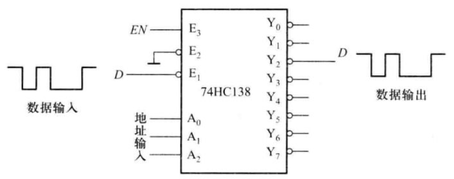
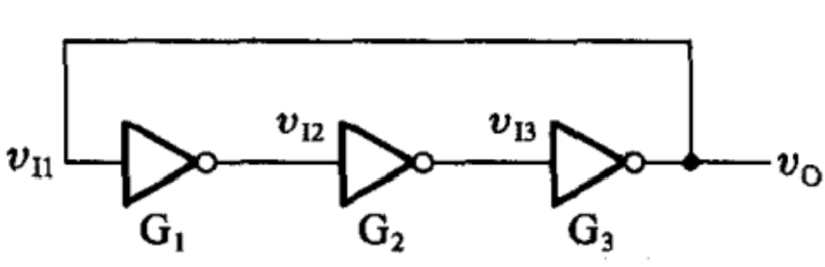
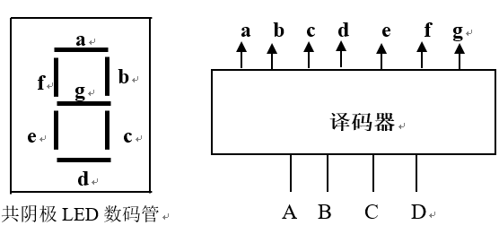

# 2025数字逻辑 - 第五周作业题目与作答清单

## 一、单选题

### R2-1 (分数: 2分)

图示电路，若实现图示功能。则译码器的地址输入端 $A_2A_1A_0$ 应接（ ）。

**选项：**

- [ ] **A.** 111
- [x] **B.** 010
- [ ] **C.** 电路无法实现输出波形
- [ ] **D.** 任意

### R2-2 (分数: 2分)

图示电路，以下说法正确的是（ ）。

**选项：**

- [ ] **A.** 电路可以起振，产生方波，其周期为非门延迟时间 $t_{pd}$ 的3倍
- [x] **B.** 电路可以起振，产生方波，其周期为非门延迟时间 $t_{pd}$ 的6倍
- [ ] **C.** 电路可以起振，产生方波，周期为非门延迟时间 $t_{pd}$ 的9倍
- [ ] **D.** 电路为闭环，没有输入，所以电路中没有产生波形

### R2-3 (分数: 2分)

8:3优先编码器74LS148，8条输入线I0--I7同时为有效电平（0）时，则输出编码为（ ）。

**选项：**

- [ ] **A.** 111
- [ ] **B.** 010
- [x] **C.** 000
- [ ] **D.** 101

### R2-4 (分数: 2分)

数据分配器一般用（ ）实现其功能。

**选项：**

- [ ] **A.** 选择器
- [x] **B.** 译码器
- [ ] **C.** 编码器
- [ ] **D.** 与非门

### R2-5 (分数: 2分)

下图是共阴极七段LED数码管显示译码器框图，若要显示字符“5”，则译码器输出g～a应为（ ）,g是高位。

**选项：**

- [ ] **A.** 1101100
- [x] **B.** 1101101
- [ ] **C.** 1100011
- [ ] **D.** 0100100

### R2-6 (分数: 2分)

用译码器74LS138实现8路数据分配器时，是用（ ）做数据输入端。

**选项：**

- [ ] **A.** 地址端
- [ ] **B.** 高有效使能端
- [ ] **C.** 数据端
- [x] **D.** 低有效使能端

## 二、主观题

### R8-1 第二章第（13）题 (分数: 10分)

用一片4:16线译码器将8421BCD码转换成余三码，写出表达式，画出逻辑图。

---

### R8-2 用74LS138实现第二章第（9）题 (分数: 10分)

第二章第（9）题。用红、黄、绿三个指示灯表示三台设备的工作情况：绿灯亮表示全部正常；红灯亮表示有一台不正常；黄灯亮表示有两台不正常；红、黄灯全亮表示三台都不正常，要求用74LS138和与非门实现。

---

### R8-3 第二章第（11）题 (分数: 10分)

用一片74LS148和与非门实现8421BCD优先编码器，输入低电平有效，I9线优先级最高，要求输出为8421原码。

（先自己做，ppt上有解答）

---
