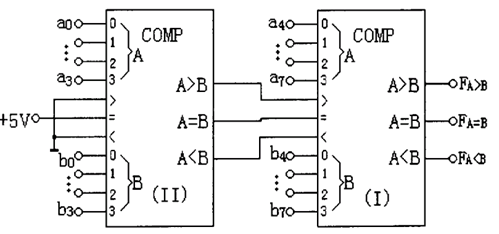
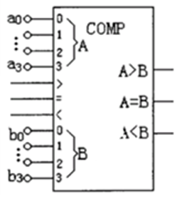
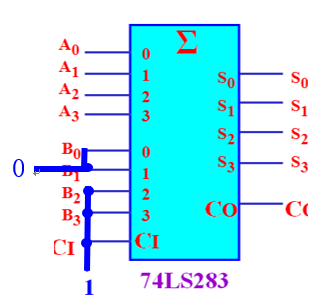
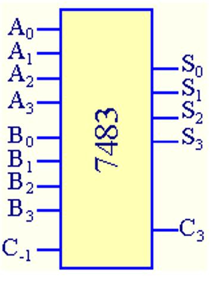
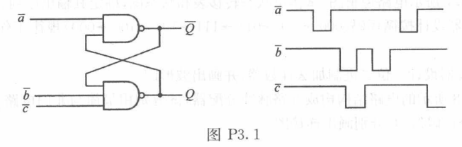

# 2025数字逻辑 - 第六周作业题目与作答清单

## 一、单选题

### R2-1 (分数: 2分)

已知两个八位二进制数A=11110111和B=11110100进行比较，电路连接如图7-1所示。I号芯片的三个级联输入端 >、=、< 的信号分别是（ ）。

**选项：**

- [ ] **A.** 0、0、1
- [ ] **B.** 0、0、0
- [ ] **C.** 1、0、0
- [x] **D.** 0、1、0

### R2-2 (分数: 2分)

已知两个四位二进制数A和进行比较，电路连接如图所示，比较器芯片的三个级联输入端>, = ,< 的信号应依次接入为（ ）。

**选项：**

- [ ] **A.** 101
- [ ] **B.** 111
- [ ] **C.** 000
- [x] **D.** 010

### R2-3 (分数: 2分)

函数 $F=\overline{A}C+AB+\overline{B}\,\overline{C}$, 无冒险的组合为（ ）。

**选项：**

- [ ] **A.** B=C=1
- [ ] **B.** A=1，C=0
- [ ] **C.** A=B=0
- [x] **D.** B=C=0

### R2-4 (分数: 2分)

下列有关组合电路中险象的叙述错误的是（ ）。

**选项：**

- [x] **A.** 由于电路未达到最简引起的
- [ ] **B.** 是一种暂时的错误
- [ ] **C.** 险象只发生在输入信号变化的时刻
- [ ] **D.** 由于电路的时延引起的

### R2-5 (分数: 2分)

利用全加器74LS283将余三码转8421码，只需要加上（ ）即可。

**选项：**

- [ ] **A.** 0011，CI端接1
- [x] **B.** 1100 ，CI端接1
- [ ] **C.** 1101，CI端接1
- [ ] **D.** 1100，CI端接0

### R2-6 (分数: 2分)

下列表达式中不存在竞争冒险的是（ ）。

**选项：**

- [ ] **A.** $F=(A+\bar{B})·（\bar{A}+D)·（C+B）$
- [ ] **B.** $F=AB+\bar{A}C+\bar{B}D$
- [ ] **C.** $F=(A+B)·（\bar{A}+D)$
- [x] **D.** $F=A\bar{B}D+\bar{A}\bar{C}+\bar{B}\bar{C}D$

### R2-7 (分数: 2分)

串行加法器加法器的进位信号采用（ ），并行加法器的进位信号采用（ ）

**选项：**

- [ ] **A.** 超前，逐位
- [x] **B.** 逐位，超前
- [ ] **C.** 超前，超前
- [ ] **D.** 逐位，逐位

### R2-8 (分数: 2分)

由或非门构成的RS触发器，为避免不定状态的发生，输入不能出现（ ）

**选项：**

- [ ] **A.** R=S=0
- [ ] **B.** R=0,S=1
- [x] **C.** R=S=1
- [ ] **D.** R=1,S=0

### R2-9 (分数: 2分)

串行进位加法器，描述正确的是（ ）

**选项：**

- [ ] **A.** 加法器采用串行进位，工作速度很快。
- [ ] **B.** 加法器最高位的求和输出, 直接由两位最高位的运算产生
- [x] **C.** 加法器求和的最高位输出必须等到各位进位信号逐位传递后才能形成。
- [ ] **D.** 串行进位加法器比超前进位并行加法器延迟时间短。

### R2-10 (分数: 2分)

图示逻辑电路的功能是（ ）。

**选项：**

- [ ] **A.** 二进制码转循环码
- [x] **B.** 余3码转8421码
- [ ] **C.** 8421码转余3码
- [ ] **D.** 循环码转进制码

### R2-11 (分数: 2分)

下列各函数等式中无冒险现象的函数$式是（ ）。

**选项：**

- [x] **A.** $F=\overline{B}\,\overline{C}+AC+\overline{A}B+BC+A\overline{B}+\overline{A}\,\overline{C}$
- [ ] **B.** $F=\overline{A}\,\overline{C}+BC+A\overline{B}$
- [ ] **C.** $F=\overline{B}\,\overline{C}+AC+\overline{A}B+A\overline{B}$
- [ ] **D.** $F=\overline{B}\,\overline{C}+AC+\overline{A}B$

### R2-12 (分数: 2分)

由与非门构成的RS触发器，为避免不定状态的发生，输入不能出现（ ）

**选项：**

- [ ] **A.** R=1,S=0
- [ ] **B.** R=0,S=1
- [ ] **C.** R=S=1
- [x] **D.** R=S=0

## 二、主观题

### R8-1 第二章第（15）题（用全加器和与非门实现） (分数: 10分)

#### 题目描述

用74LS283全加器和与非门设计实现一位8421 BCD码加法器电路。

（课件上有完整的解题答案）

---

### R8-2 第二章第（14）题 (分数: 10分)

#### 题目描述

使用一个4位二进制加法器设计将余三码转换成8421BCD码的转换器。

---

### R8-3 第三章 第1题 (分数: 10分)

#### 题目描述

由与非门构成的触发器如图示，写出触发器的次态方程，并根据已给波形画出输出 $Q$ 的波形。设初始状态为1。

提示：题目是低有效的RS触发器。a、b、c上的非号仅仅代表低有效的意思，可以忽视。输入b、c的与运算就是S信号。

---
