# 2025数字逻辑 - 第七周作业题目与作答清单

## 一、单选题

### R2-1 (分数: 2分)

下列各触发器中，图（ ）触发器的输入、输出信号波形图如下图所示。

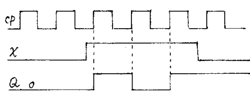

**选项：**

- [ ] **A.** 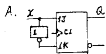
- [ ] **B.** 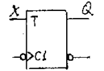
- [ ] **C.** 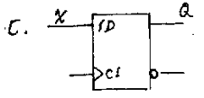
- [D] **D.** 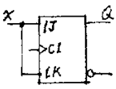

### R2-2 (分数: 2分)

由下图可知电路的逻辑功能是（ ）。

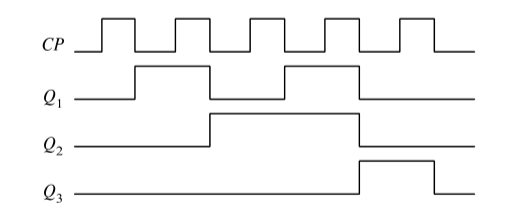

**选项：**

- [x] **A.** 5进制计数器
- [ ] **B.** 4进制计数器
- [ ] **C.** 6进制计数器
- [ ] **D.** 8进制计数器

### R2-3 (分数: 2分)

JK触发器在CLK脉冲作用下，欲使 $Q^{(n+1)}=Q^{n}$，则输入信号应为（ ）。

**选项：**

- [ ] **A.** $J=\overline{Q},\ K=Q$
- [ ] **B.** $J=\overline{Q},\ K=1$
- [ ] **C.** $J=K=1$
- [x] **D.** $J=K=0$

### R2-4 (分数: 2分)

为实现将JK触发器转换为D触发器，图所示电路的虚线框内应是（ ）。

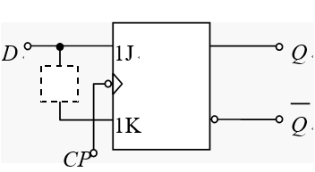

**选项：**

- [ ] **A.** 与非门
- [x] **B.** 非门
- [ ] **C.** 或门
- [ ] **D.** 异或门

## 二、主观题

### R8-1 第三章第（3）题 (分数: 10分)

#### 题目描述

已知JK信号如图，请画出负边沿JK触发器的输出波形（设触发器的初态为0）。

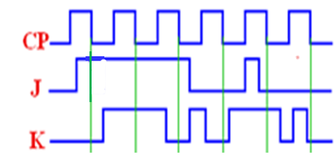

---

### R8-2 第三章第（4）题 (分数: 10分)

#### 题目描述

写出图3.4所示各触发器次态方程，指出CP脉冲到来时，触发器置“1”的条件。

提示：先写出D、J、K的表达式，再根据状态方程确定置1的条件。

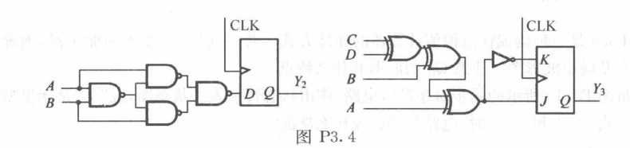

---

### R8-3 第三章第（5）题 (分数: 10分)

#### 题目描述

写出各触发器的次态方程，并按所给的CP信号，画出各触发器的输出波形（设初态为0）。

说明：图示画法中悬空的引脚K都表示接高电平 `1`，这种是不严格画法。正确的画法是将输入端的K端都接入确定的高电平。

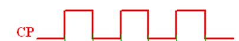

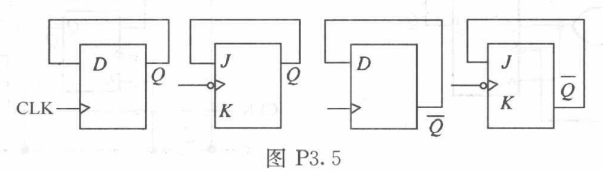

---

### R8-4 第三章第7题 (分数: 10分)

#### 题目描述

分析如图所示电路，写出输出各触发器状态方程、写出电路真值表、状态图（按 $Q_3Q_2Q_1$ 的顺序）。说明电路是几进制计数器，能否自启动。

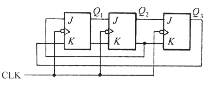

---

### R8-5 第三章第13题 (分数: 10分)

#### 题目描述

分析图示电路，写出输出方程、状态方程、真值表、状态图（$Q_2Q_1$），说明电路的逻辑功能。

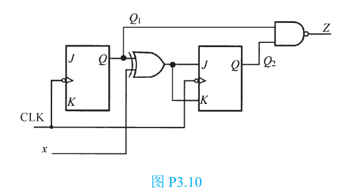

---

### R8-6 第三章第14题 (分数: 10分)

#### 题目描述

分析图示电路，写出输出方程、状态方程、真值表、状态图（$Q_2Q_1$），说明电路的逻辑功能。

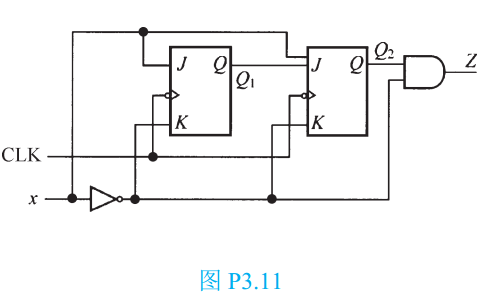

---
