# 2025数字逻辑 - 第八周作业题目与作答清单

## 一、单选题

### R2-1 (分数: 2分)

某电视机水平-垂直扫描发生器需要一个分频器，将31500Hz脉冲转换为60Hz脉冲，欲构成此分频器至少需要（ ）个触发器。

**选项：**

- [ ] **A.** 60
- [ ] **B.** 31500
- [x] **C.** 10
- [ ] **D.** 525

### R2-2 (分数: 2分)

一个4位二进制减法计数器的起始值是1001，经过100个时钟脉冲作用之后的值为（ ）

**选项：**

- [x] **A.** 0101
- [ ] **B.** 0100
- [ ] **C.** 1100
- [ ] **D.** 1101

### R2-3 (分数: 2分)

移位型计数器中有两种常用计数器，即环形计数器和扭环形计数器，其中环形计数器中，如果触发器级数为n，则该计数器的计数模为（ )

**选项：**

- [x] **A.** n
- [ ] **B.** n/2
- [ ] **C.** 2n
- [ ] **D.** $2^n$

### R2-4 (分数: 2分)

下图电路中，若起始是1110，则经过62个CP后，状态 $Q_0Q_1Q_2Q_3$ 是（ ）

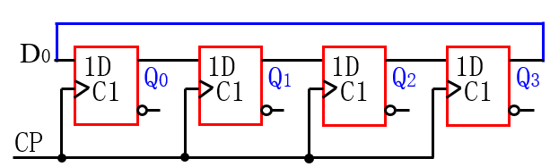

**选项：**

- [ ] **A.** 0111
- [ ] **B.** 1100
- [ ] **C.** 1101
- [x] **D.** 1011

### R2-5 (分数: 2分)

用（ ）电路构成模8计数器的译码电路最简

**选项：**

- [ ] **A.** 异步计数器
- [ ] **B.** 扭环形计数器
- [x] **C.** 环形计数器
- [ ] **D.** 同步计数器

### R2-6 (分数: 2分)

移位型计数器中有两种常用计数器，即环形计数器和扭环形计数器，其中扭环形计数器中，如果触发器级数为n，则该计数器的计数模为（ ）

**选项：**

- [ ] **A.** $2^2$
- [ ] **B.** n/2
- [ ] **C.** n
- [x] **D.** 2n

### R2-7 (分数: 2分)

模12计数器至少有（ ）触发器

**选项：**

- [x] **A.** 4
- [ ] **B.** 3
- [ ] **C.** 12
- [ ] **D.** 6

### R2-8 (分数: 2分)

下图电路中，若起始是1111，则经过46个CP后，状态 $Q_0Q_1Q_2Q_3$ 是（ ）

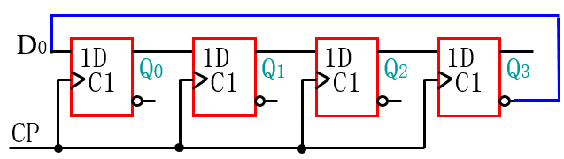

**选项：**

- [ ] **A.** 1000
- [x] **B.** 1100
- [ ] **C.** 1110
- [ ] **D.** 0000

### R2-9 (分数: 2分)

仅仅用四位移位寄存器可以构成（ ）路顺序脉冲

**选项：**

- [ ] **A.** 10
- [ ] **B.** 16
- [x] **C.** 4
- [ ] **D.** 8

### R2-10 (分数: 2分)

4位移位寄存器，串行输入时经（ ）个CP后，4位数码能全部移入寄存器中，若将其串行输出，则再需经（ ）个CP脉冲后，数码才能全部输出。

**选项：**

- [ ] **A.** 8 ， 8
- [x] **B.** 4 ， 4
- [ ] **C.** 8 ， 0
- [ ] **D.** 4 ， 0

### R2-11 (分数: 2分)

若产生10路顺序脉冲，仅用四位双向移位寄存器74LS194，不能使用其他逻辑门，则至少需要（ ）片。

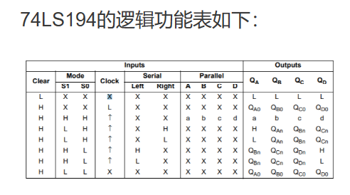

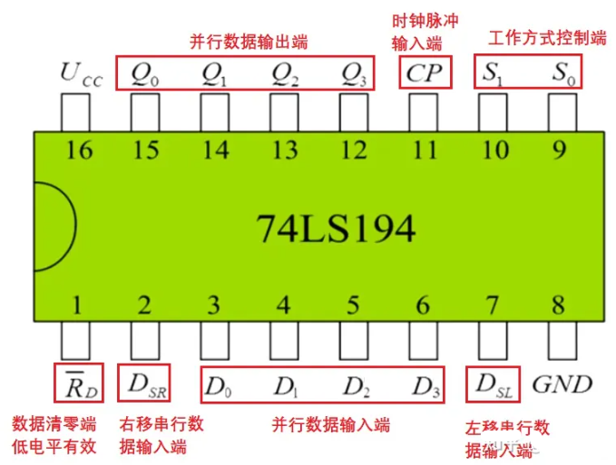

**选项：**

- [ ] **A.** 2
- [ ] **B.** 5
- [ ] **C.** 10
- [x] **D.** 3

### R2-12 (分数: 2分)

电路中W、X、Y、Z各点的频率为（ ）。

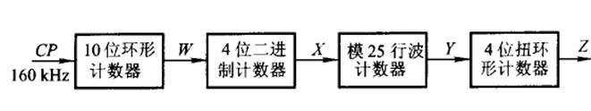

**选项：**

- [ ] **A.** 16KHz, 1KHz, 40Hz, 10Hz
- [ ] **B.** 16KHz, 2KHz, 80Hz, 20KHz
- [ ] **C.** 16KHz, 4KHz, 160Hz, 40Hz
- [x] **D.** 16KHz, 1KHz ,40Hz, 5Hz

## 二、主观题

### R8-1 设计100进制计数器 (分数: 10分)

使用74LS161和必要的门电路设计100进制计数器，要求使用Load端，且必须出现0状态。

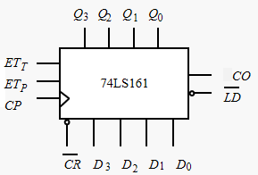

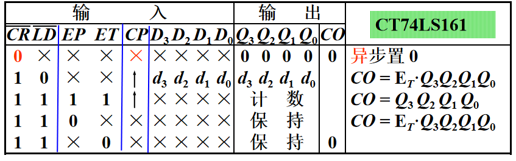

---

### R8-2 设计模8计数器 (分数: 10分)

使用 74LS163 分别设计 3 种模 8 计数器。

（1）必须出现 0000 状态。

（2）不能出现 0000 和 1111 状态，必须出现 0011 状态。

（3）除了 74LS163 之外，只能使用一个非门。

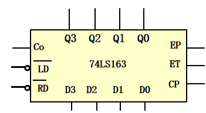

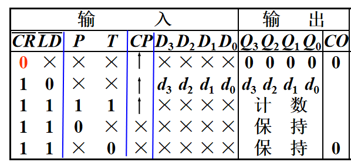
### R8-3 分析图示计数器的模值 (分数: 10分)

电路如图示，分别写出，当芯片为 74LS160、74LS161、74LS162、74LS163 时，计数器的模值。

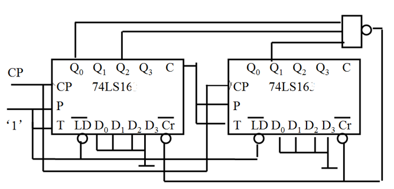

#### 提交答案 / 作答内容

- 74LS160：25
- 74LS161：37
- 74LS162：26
- 74LS163：38

---

### R8-4 分析计数器的模值（2） (分数: 10分)

分析图示电路的模值，当芯片分别为 74LS160、74LS161、74LS162、74LS163 时。

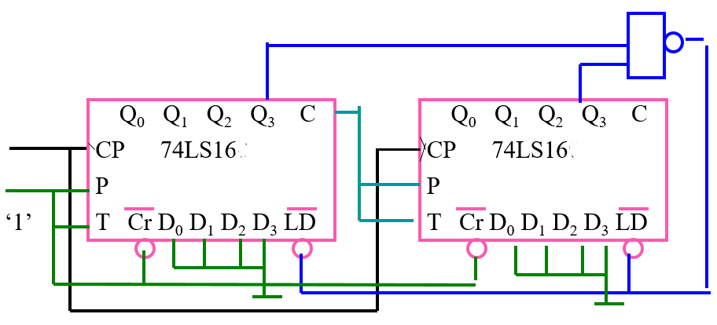

---

### R8-5 第三章第（12）题 (分数: 10分)

12. 图 P3.9 是一种构成任意模值计数器的连接方式。若要连接成 12 进制加法器，预置值应为多少？画出状态及输出波形图。注意 $Q_D$ 的波形有什么特点。

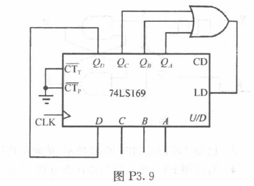

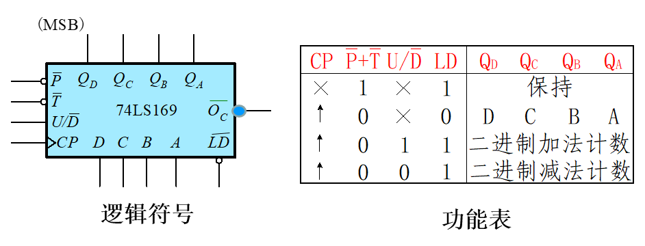

#### 提交答案 / 作答内容

QD的波形6个时钟信号变一次

---
