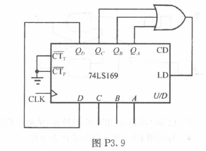
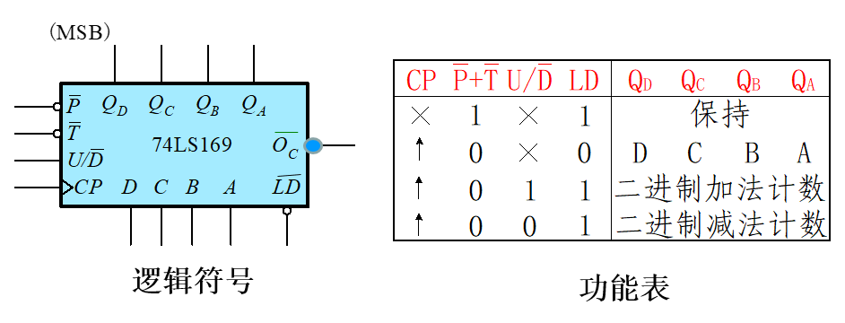
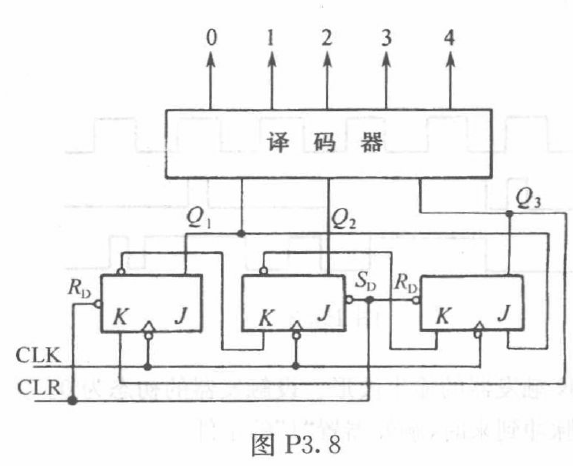
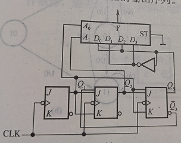

# 2025数字逻辑 - 第九周作业题目与作答清单

## 一、单选题

*本周无单选题*

## 二、主观题

### R8-1 第三章第（12）题 (分数: 10分)

12. 图 P3.9 是一种构成任意模值计数器的连接方式。若要连接成 12 进制加法器，预置值应为多少？画出状态及输出波形图。注意 $Q_D$ 的波形有什么特点。

---

### R8-2 第三章第（11）题 (分数: 10分)

下图所示的电路结构构成五路脉冲分配器（要求输出正脉冲），试分别用最简与非门电路及74LS138集成译码器构成这个译码器，并画出连线图。

提示：先分析三个JK触发器构成的时序逻辑（五个计数状态是什么），再用设计组合逻辑的方法设计译码器（与非门实现）；用73LS138时，注意调整输出线的顺序及要求的正脉冲（依次轮流出现高电平）。

---

### R8-3 分析序列信号发生器 (分数: 10分)

分析图示序列信号发生器。（1）分析计数器模值；（2）写出输出序列。

提示：按时序电路分析的方法，先分析三个JK触发器构成多少进制的计数器（按 $Q_3Q_2Q_1$ 的顺序写出状态）。图中给出的组合逻辑不会对时序逻辑产生任何影响。

---
