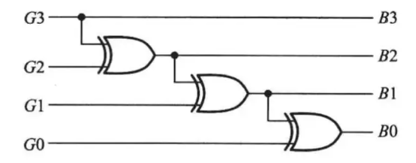

# 2025数字逻辑 - 第11周作业题目与作答清单

## 一、单选题

### R2-1 (分数: 2分)

Verilog使用的是（ ）值逻辑。

**选项：**

- [ ] **A.** 二值逻辑
- [ ] **B.** 九值逻辑
- [x] **C.** 四值逻辑
- [ ] **D.** 八值逻辑

### R2-2 (分数: 2分)

Verilog语言中，若 `a = 4'b1011`，那么 `^a` 的运算结果是（ ）。

**选项：**

- [ ] **A.** `4'b1111`
- [ ] **B.** `1'b10`
- [x] **C.** `1'b1`
- [ ] **D.** `'b1011`

### R2-3 (分数: 2分)

Verilog语言中，若 `a = 4'b1110`，`b = 5'b01110`，则以下正确的运算结果是（ ）。

**选项：**

- [ ] **A.** `a & b = 0`
- [ ] **B.** `a & b = 1`
- [x] **C.** `a && b = 1`
- [ ] **D.** `a && b = 5'b01110`

### R2-4 (分数: 2分)

Verilog语言中，`always` 块中的语句是（ ）。

**选项：**

- [ ] **A.** 并行
- [ ] **B.** 不一定
- [ ] **C.** 顺序
- [x] **D.** 顺序或并行

### R2-5 (分数: 2分)

若 `reg [15:0] MEM [0:1023]`，则存储器 `MEM` 字的位数是（ ）。

**选项：**

- [ ] **A.** 1024
- [ ] **B.** 1K×16
- [x] **C.** 16
- [ ] **D.** 15

### R2-6 (分数: 2分)

在Verilog语言中，设 `D0` 为 `'1'`，`D1` 为 `'0'`，`D2` 为 `'1'`，`D3` 为 `'0'`，则 `{D3, D2, D1, D0}` 的运算结果是（ ）。

**选项：**

- [ ] **A.** `0`
- [ ] **B.** `1`
- [x] **C.** `"0101"`
- [ ] **D.** `"1010"`

## 二、主观题

### R8-1 verilog设计4路数据分配器 (分数: 10分)

#### 题目描述

Verilog设计4路数据分配器，带使能端。未被分配的输出为 `'1'`。递交源码，及仿真波形的截图或生成的网表文件截图。

模块为：`module demus_4 ( ... input [1:0] A , ... );`

提示：用拼接运算实现 `F`，如使用 `case` 语法的选择：

```verilog
case (A)
    // ...
    2'b10 : F = {1'b1, D, 2'b11};
    // ...
endcase
```


---

### R8-2 verilog实现编码转换 (分数: 10分)

#### 题目描述

verilog实现将输入的四位格雷码转换为二进制码。给出源代码及仿真截图（或网表文件）。



---

### R8-3 verilog设计4位全减器 (分数: 10分)

#### 题目描述

用verilog语言设计4位全减器，要求提交源码，及仿真波形图或网表文件。

---

### R8-4 用verilog语言实现一个8421码全加器。如 8+9=17. (分数: 10分)

#### 题目描述

用verilog语言实现一个8421码全加器。如 8+9=17.

提示：

```verilog
// ...
reg [4:0] sumtemp;
// ...
if (sumtemp > 5'd9) begin // 判9加6
    // ...
end else begin
    sum = sumtemp[3:0];
    co = 1'b0;
end
```

#### 提交答案 / 作答内容

```verilog
module sum4(
    input [3:0] first, second,
    input co,
    output reg [3:0] sum,
    output reg go
);
    reg [4:0] sumtemp;

    always @(*) begin
        sumtemp = first + second + co;
        if (sumtemp > 5'd9) begin
            sumtemp = sumtemp + 4'b0110;
            go = 1'b1;
            sum = sumtemp[3:0];
        end
        else begin
            sum = sumtemp[3:0];
            go = 1'b0;
        end
    end
endmodule
```

---
