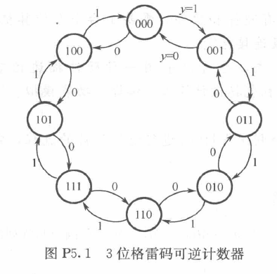
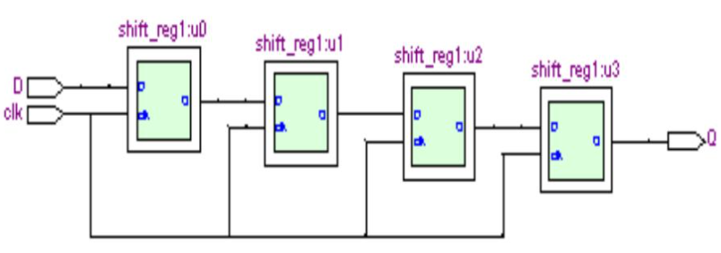
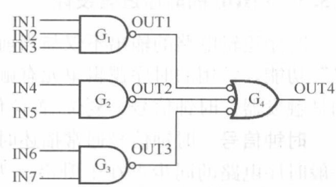
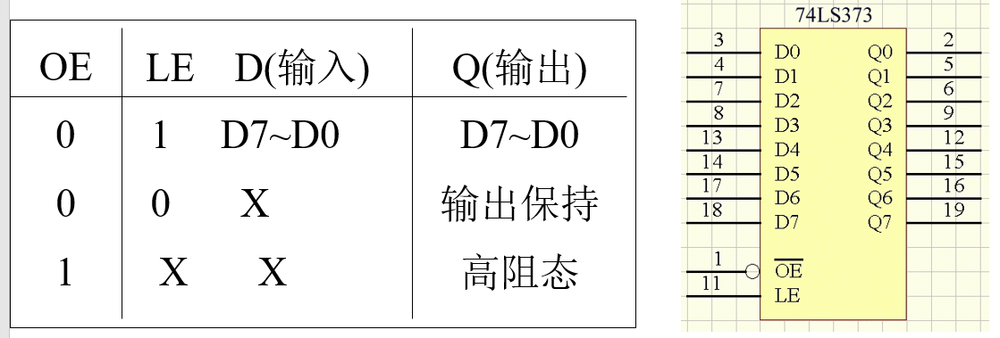
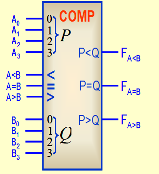

# 2025数字逻辑 - 第12周作业题目与作答清单

## 一、单选题

*本周无单选题*

## 二、主观题

### R8-1 第五章作业第20题，用个verilog设计状态机（格雷码计数器） (分数: 10分)

#### 题目描述

用verilog描述以下状态机（3位格雷码计数器，即8进制），y=1时做计数器加，y=0时做计数器减。提交代码，（不需要仿真）。

提示：输出的计数状态用 output reg [2:0] qout ; 的qout信号输出，不要使用状态常量（参数）的编码。

#### 提交答案 / 作答内容

module glay(

input y,

input clk,

output reg [2:0] qout

);

always@(posedge clk)begin

if(y==1)begin

case(qout)

3'b000: qout=3'b001;

3'b001: qout=3'b011;

3'b011: qout=3'b010;

3'b010: qout=3'b110;

3'b110: qout=3'b111;

3'b111: qout=3'b101;

3'b101: qout=3'b100;

3'b100: qout=3'b000;

default:qout=3'b000;

endcase

end

else begin

case(qout)

3'b000: qout=3'b100;

3'b001: qout=3'b000;

3'b011: qout=3'b001;

3'b010: qout=3'b011;

3'b110: qout=3'b010;

3'b111: qout=3'b110;

3'b101: qout=3'b111;

3'b100: qout=3'b101;

default:qout=3'b000;

endcase

end

end

endmodule

---

### R8-2 用verilog层次化设计实现移位寄存器 (分数: 10分)

#### 题目描述

用verilog层次化设计 描述4位移位寄存器。递交底层、顶层两个设计文件的源码、顶层的网表文件。

---

### R8-3 verilog 描述层次化设计-第五章第（9）题 (分数: 10分)

#### 题目描述

用元件例化语句实现，递交顶层设计的源码，及网表文件。

G4门的逻辑可以在底层模块描述中，将三个输入引脚各自做非运算后再或。

---

### R8-5 用verilog设计具有异步清零的8位寄存器 (分数: 10分)

#### 题目描述

用verilog设计具有异步清零（低有效）的8位寄存器。提交代码，仿真截图或网表文件。

---

### R8-6 用verilog设计8位锁存器74LS373 (分数: 10分)

#### 题目描述

用verilog设计8位锁存器74LS373。要求递交源码及网表文件。

注意：锁存器在锁存信号有效（LE=1）期间内，输出跟随输入变化。

建议：写出一个always过程块描述latch，另一个assign描述三态输出。

---

### R8-7 用verilog设计60进制计数器 (分数: 10分)

#### 题目描述

用verilog设计60进制加法计数器。要求有（低有效）同步清零和有进位输出功能。要求提交代码及仿真截图（或网表文件）。

---

### R8-8 verilog设计比较器 (分数: 10分)

#### 题目描述

verilog设计中规模比较器74LS85的逻辑功能。递交源码，及仿真波形的截图或生成的网表文件截图。
模块为：module comp (ain, bin, aL , aE , aG, f1 ,f2 ,f3 ) ;
/*aL表示级联输入 a<b , aE级联输入a=b，aG表示级联输入 a>b ,
f1表示输出a<b , f2表示a=b , f3表示 a>b */

提示：
if （····）
begin
·······
end
else if （ ）
begin
······
end
else
begin
case ({aL,aE,aG})
············
default:
begin
f1 = 1'b0 ;
f2 = 1'b0 ;
f3 = 1'b0 ;
end
·················

---
