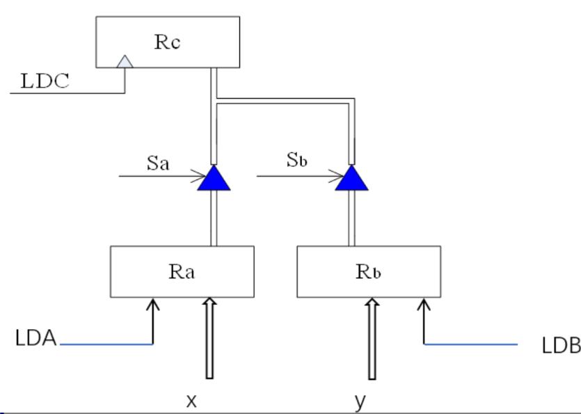
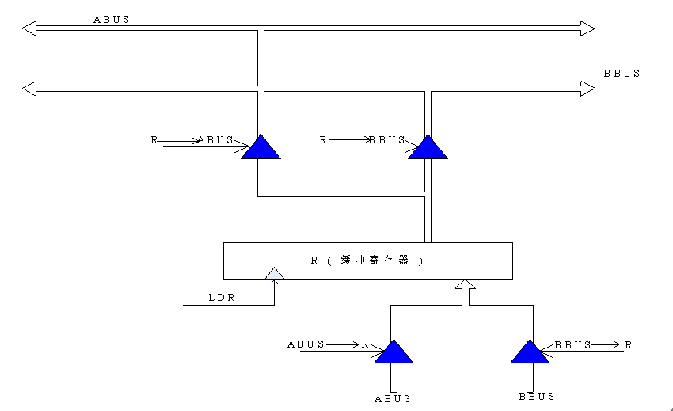
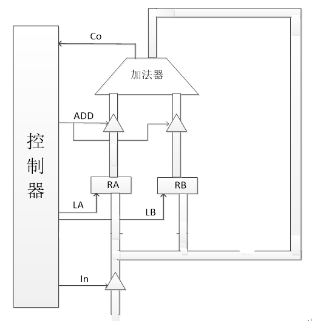

# 2025数字逻辑 - 第十五周作业题目与作答清单

## 一、单选题

*本周无单选题*

## 二、主观题

### 8-1 给出ASM图-1 (分数: 10分)

按已知数据通路，给出先执行 $X \to R_C$ 操作，再执行 $Y \to R_C$ 操作的ASM图。

---

### 8-2 给出ASM图-3 (分数: 10分)

一个系统有A、B两条总线，为了接收来自A总线上的数据并驱动B总线（将A总线的数据送到B总线），给出已知数据通路的ASM图。

---

### 8-3 设计加法控制器 (分数: 10分)

已知数据通路如图所示，完成两个数的加法操作，当有进位时将和数送A寄存器，否则送B寄存器。初始时A和B中为随机数。要求：（1）根据数据通路，设计控制器的ASM图；（2）用D触发器分别实现计数型、定序型（一对一法）、选择器型控制器，要求写出控制命令的表达式、状态转移表、次态方程，状态触发器的激励方程。

---
